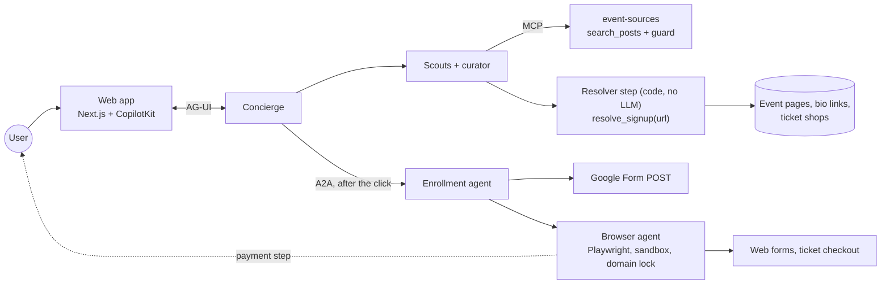

# Sidequest (Event Scout) – Plan after the hackathon

> Status: 2026-11-22. The hackathon MVP works end to end (see [README.md](README.md), section "Status").
> The hackathon plan (deadlines, team split P1–P4, schedule, demo script) is in the git history: `git show b2000e9:PLAN.md`.
>
> **New goal:** Sidequest signs you up for **every** event it suggests. For each event, the app offers the correct next action. The agents do all steps up to the point where the law or the platform needs your own action (pay, send a DM).

## 1. Definition of done

- Every event card has a verified sign-up kind (section 3). Target: less than 10 % `unknown` on live data.
- A card proposes a DM **only** when the post asks for a DM.
- Events without a sign-up ("just go") get time, place, door price, route and a calendar entry. No invented sign-up.
- Free sign-ups (Google Form, other web forms): the agent completes them after one click.
- Tickets: the agent shows a verified price and availability, fills the checkout and stops at the payment step. You confirm the amount and pay.
- "Sign me up for all": one review list for all selected events. Free actions run with one click. Each payment needs its own confirmation.

## 2. Where we are

What works today: profile → parallel scan (MCP + injection guard) → ranked cards → click → A2A → Google Form POST, or a DM draft, or instructions. Details in the README.

### Gaps for the new goal

| Gap | Where | Effect |
|---|---|---|
| `enrollment_mode` knows only `auto`, `manual` and `unknown` | `shared/schemas.py` | There is no value for "no sign-up needed" and no value for "tickets" |
| The curator sets `manual` for DM, website and box office alike | `agents/scouts/agent.py`, `_curator_instruction` | The enrollment agent cannot see what kind of manual step it is |
| The enrollment LLM chooses the sign-up path. For `manual` or `unknown` it often calls `prepare_message_signup` | `agents/enrollment/agent.py`, instruction steps 3 and 4 | **Demo bug:** a club night got "sign up by DM" |
| Only links in the post text count. "Link in bio" and ticket shop pages are never read (no fetch tool, on purpose) | `_finalize_events` | Most tickets stay invisible. The live Heaven Münster posts only say "Ticket Link in Bio" |
| Automatic sign-up works only for Google Forms with exactly "Name" and "Email" | `submit_google_form` | Other forms (Eventbrite, pretix, own websites) are manual |
| The card button says "Enroll me" or "Get sign-up steps", nothing else | `web/components/EventCards.tsx:77` | No "Buy ticket", no "Just go" |
| Deduplication only by `source_url` | `_finalize_events` | One event in 7 posts gives up to 7 cards (live data: Heaven Münster) |
| Demo sign-in, in-memory sessions, free-tier Gemini | `web/lib/session.ts`, `agents/concierge/app.py` | Real personal data is not allowed yet: Google can use free-tier data for product improvement |

### The demo bug: a club night got "sign up by DM"

Example from the live data: "TANZ DER VAMPIRE", Sputnikhalle, 21.11.2026. The post only describes the night: DJs, floors, "Eintritt: 10,00€", "Barzahlung und KARTENZAHLUNG an der Kasse". There is no sign-up. Its link goes to a prize draw ("2 x 2 Tickets zu gewinnen"), not to a sign-up. The "Black Friday Vintage Pop-up" in the Cuba Club ("2 € Eintritt") is the same case.

Correct behavior:
1. The post says how to get in at the door, or it gives no sign-up hint → the resolver looks for a ticket shop (section 4). If it finds none → **"Just go"**: time, place, door price, route, calendar link. No message.
2. A ticket shop exists (in the post, in the bio, on the organizer website) → **"Buy ticket · 10 €"** with the verified offer.
3. The post asks for a DM or an email → message draft (exists today).

## 3. Sign-up kinds (the core change)

`signup` replaces `enrollment_mode`. **Code** sets the final value. The LLM only proposes it.

| `signup` | Detected by | Agent does | You do | Result status |
|---|---|---|---|---|
| `none` | "Eintritt frei", "Abendkasse", "keine Anmeldung nötig", or no hint and the resolver finds no ticket shop | Calendar link, route link (`mapsOpenUrl` in `web/lib/maps.ts`), door price from the post | Go there | `not_needed` |
| `google_form` | Link host `docs.google.com/forms` or `forms.gle` (code check, exists) | HTTP POST (exists) | One click | `registered` |
| `web_form` | Resolver finds a free registration page on another site | Browser agent fills name and email, shows a screenshot, submits after your confirmation | Click + confirm | `registered` |
| `tickets` | Resolver finds a ticket offer (post link, bio link, organizer website) | Reads price and availability, fills the checkout up to the payment step | Confirm the amount, pay | `purchased` |
| `message` | Post text asks for a DM or an email (code regex: `DM`, `Direktnachricht`, `schreib uns`, `per Mail`, an email address) | Draft + chat link (exists). Later: send the email with the Gmail API after your confirmation | Send the DM | `manual` |
| `link_in_bio` | Post says "Link in Bio" | Intermediate value only. The resolver replaces it | – | – |
| `unknown` | Resolver finds nothing and the post says a sign-up is required | Post link + "No sign-up link found". **Never** a DM draft | Open the post | `manual` |

Rules in code, not in the prompt:
- `message` only if the post text matches the DM/email pattern. Otherwise `unknown`.
- `google_form` only from the host check. `tickets` and `web_form` only from a resolver result, never from the LLM alone.
- The enrollment path follows `signup` in code. The `before_tool_callback` blocks `prepare_message_signup` if `signup != "message"`. The LLM only writes the text.
- Prize draws ("Tickets zu gewinnen") are not a sign-up. Later, show them as an extra link.

Schema proposal (`shared/schemas.py` and the mirror `shared/schemas.ts`; agree with the team first, see `CLAUDE.md`):

```python
SignupKind = Literal["none", "google_form", "web_form", "tickets", "message", "link_in_bio", "unknown"]

class TicketOffer(BaseModel):
    url: HttpUrl                  # shop page for this event
    price: str | None = None      # from the shop page, not from the post
    availability: Literal["available", "sold_out", "unknown"] = "unknown"
    checked_at: datetime

class SocialPost(BaseModel):      # new field
    author_bio_url: HttpUrl | None = None   # bio link of the account, from the data provider

class Event(BaseModel):           # enrollment_mode -> signup
    signup: SignupKind = "unknown"
    signup_hint: str = ""         # quote from the post, e.g. "Eintritt 10 € an der Kasse"
    ticket: TicketOffer | None = None

class EnrollmentResult(BaseModel):
    status: Literal["registered", "purchased", "not_needed", "manual", "failed"]
```

## 4. Architecture changes



### Resolver (new, read-only)

Finds the real sign-up path behind a link. It is deterministic code in `mcp_servers/event_sources/` (next to the guard), also exposed as a second MCP tool `resolve_signup(url)`. A code-only step after the curator (a custom `BaseAgent` without an LLM) calls it for each event that has a link or `link_in_bio`.

- **Input:** only URLs from the post text or the account's `author_bio_url`. The LLM cannot add URLs.
- **Limits:** `https` only, public IPs only (no SSRF to `localhost` or private ranges), max. 2 redirects, max. 1 MB, 10 s timeout, no cookies. Max. 1 hop (bio page such as linktr.ee → event page).
- **Ticket offer:** read schema.org JSON-LD first (`Event` → `offers`: `price`, `availability`, `url`). This is code, no LLM. Many ticket shops publish it for Google's event search (check this for each shop we see in the live data). Fallback: guard + small Gemini extraction with an output schema.
- **Bio pages:** choose the link that matches the event title or date.
- **Guard:** the page text goes through `is_poisoned` before an LLM sees it.
- **Cache:** per URL, 1 hour (availability changes).
- *Later:* a web search for "<title> <venue> <date> Tickets", with only result hosts from a ticket-shop allowlist.

### Browser agent (new, in the enrollment agent)

For `web_form` and `tickets`. Start with Playwright MCP (`@playwright/mcp`; `.playwright-mcp/` is already in `.gitignore`). Alternative: the Gemini Computer Use model.

- **Domain lock** in the `before_tool_callback` (same pattern as today): the browser opens only the host of `registration_url` or `ticket.url` from the request, plus known payment provider hosts for the hand-off.
- Fills only profile fields (name, email). A required field that is not in the profile → stop and ask in the chat (human in the loop).
- Captcha, login or account creation → stop, status `manual`, link.
- Before the submit: screenshot + summary in the chat → you confirm. After the submit: screenshot of the confirmation page into the audit log.
- Runs in a sandbox (container), without stored passwords or cookies.

### Ticket purchase in 3 stages

| Stage | What | Who pays | When |
|---|---|---|---|
| **A. Deep link** | Card shows "Buy ticket · 10 €" (verified offer). The click opens the shop page. You mark "bought" with one click | You, in the shop | Phase 2, small |
| **B. Assisted checkout** | The browser agent selects the ticket type and count, fills the buyer data and stops at the payment step. You see the live browser and pay there | You, in the live browser | Phase 5 |
| **C. Agent payment** | AP2 (Agent Payments Protocol, an extension of A2A and UCP) with a mandate that you sign, or UCP checkout, or a partner API of the ticket shop | The agent, within your mandate | Only when ticket shops support it. Evaluate, do not build now |

Rules for B:
- The agent never sees or types card data.
- The agent never clicks the final order button ("zahlungspflichtig bestellen"). German law (§ 312j BGB) wants this confirmation from the consumer.
- The agent stops if the cart total is higher than the price that you confirmed.

## 5. Roadmap

Each phase gives a usable state. Size: S = up to 1 day, M = 2–4 days, L = 1 week or more.

### Phase 1 – The correct next action for each event (fixes the demo bug) · S–M

- [x] Schema change from section 3 (`signup`, `signup_hint`, status `not_needed`), Python and TypeScript.
- [x] Curator prompt: describe the kinds with examples. Example: "club night with only a program and a door price → `none`".
- [x] `_finalize_events`: the code rules from section 3. Deduplicate by normalized title + date + venue, not only by `source_url`.
- [x] Concierge `enroll`: for `none`, answer without A2A (calendar link with `make_calendar_link`, route, door price, status `not_needed`). This is the same short path as the "no consent" case.
- [x] Enrollment agent: route by `signup` in code. The guardrail blocks `prepare_message_signup` if `signup != "message"`.
- [x] Cards: one button per kind: "Just go · add to calendar", "Enroll me", "Buy ticket · price", "Prepare message", "Open post". New status texts.
- [x] Tests: fictional fixture posts that copy the hard live cases (club night with door price → `none`, market with an entry fee → `none`, "Ticket Link in Bio" → `link_in_bio`, "Tickets nur per DM" → `message`). Do not copy the real live posts: they are third-party content (`fixtures/live_posts.json` is in `.gitignore` for this reason).

### Phase 2 – Resolver: find the real sign-up path · M

- [x] `fetch_live.py`: also get the account profile from Apify (Instagram and TikTok profile scrapers have a bio link field) and store it as `author_bio_url`.
- [x] `resolve_signup(url)` with the limits from section 4. JSON-LD first, bio pages, LLM fallback with the guard.
- [x] Resolver step after the curator. It sets `signup` and `ticket`. When it finds no ticket shop and the post does not require a sign-up, it sets `none` with the hint "No presale found, entry probably at the door".
- [x] Ticket stage A (deep link) on the card.
- [x] Guard test with a poisoned ticket page fixture.
- [ ] Measure: share of `unknown` on `fixtures/live_posts.json` before and after. Target below 10 %.

> Status 2026-11-23: Phase 1 is done. Phase 2 is done except for these points:
> - The resolver step is a second `after_agent_callback` of the curator, not a separate `BaseAgent`.
> - The LLM fallback for pages without JSON-LD is not built: JSON-LD only, no Gemini cost.
> - The hint "No presale found" is not built.
> - `fetch_live.py` has not run with the profile scraper yet.
> - Measurement: 16 of 17 cached live posts have no link in the text, so the resolver needs `author_bio_url`
>   (run `fetch_live` again). rausgegangen.de answers 403 to the resolver.

### Phase 3 – Real users and real data · M–L

Needed before agents send real sign-ups to real organizers. You can build Phase 4 in parallel against your own test forms.

- [ ] Google OAuth sign-in (real name and email). Keep the other providers only as "demo" or remove them.
- [ ] Persistent storage: ADK `DatabaseSessionService` (SQLite first, Cloud SQL or Firestore later). One table for enrollments and purchases, with the proof (`approved_at`, screenshot, confirmation).
- [ ] Paid Gemini tier or Vertex AI. On the free tier, Google can use the data.
- [ ] One env file per process (least privilege, open point from the README).
- [ ] Consent levels in the profile: "free sign-ups after my click" (default on), "ask me before every payment" (always on). Privacy notice, "delete my data".
- [ ] Live scan per request instead of the offline cache: Apify run on demand, cached, with a cost limit per user.

### Phase 4 – Browser agent for web forms (`web_form`) · M

- [ ] Playwright MCP in a container, with the domain lock and the stop rules from section 4.
- [ ] Screenshot before the submit → confirmation in the chat (frontend tool like `choose_event`) → submit → screenshot of the confirmation.
- [ ] Tests against own test forms (Google Form, a small local HTML form, a pretix test shop if possible).

### Phase 5 – Tickets: assisted checkout (stage B) · L

- [ ] Browser hand-off: you see the live browser (local headed Chrome first; for other users a cloud browser with a live view).
- [ ] Cart total check against the confirmed price. Stop at the payment step.
- [ ] Legal check before public use: terms of the ticket shops (automation), § 312j BGB, personalized tickets, refunds.
- [ ] Evaluate stage C: which ticket shops in Germany support AP2, UCP or a partner API? Ask shops for partner access.

### Phase 6 – "Sign me up for all" · M

- [ ] Button "Plan all" over the card list → review list with one row per event: planned action and cost (free sign-up, ticket 10 €, just go, DM). You can remove rows. One click starts all free actions. Each payment still needs its own confirmation.
- [ ] `choose_event` returns a list of `event_id`s with one `approved_at`. The guardrails check each event.
- [ ] Real calendar entries with the Calendar API (scope `calendar.events`) instead of template links.
- [ ] "My events" view: registered, ticket bought, just go, action needed.
- [ ] *Stretch:* read confirmation emails (Gmail API, read-only, filtered) → status "confirmed". Reminder the day before.

### Phase 7 – Operations, when there are users · M

- [ ] Cloud Run for the concierge, the enrollment agent and the web app. Model Armor as the default guard. Cloud Trace. Cost limits.
- [ ] More sources: rausgegangen.de, Eventbrite, Meetup (check their APIs and terms first). X and Facebook still need an API review.
- [ ] *Stretch from the hackathon:* event cards as A2UI.

## 6. Security: what changes

The key message stays: **the system prompt is a request, the tool set is the boundary.** Code checks every action. New capabilities bring new risks:

| New capability | Risk | Control |
|---|---|---|
| Resolver reads web pages | SSRF, prompt injection from pages | URLs only from the post or the bio, `https` + public IPs, size and time limits, guard before every LLM |
| Browser agent | A page leads the agent to other sites or makes it leak data | Domain lock in code, only profile fields, sandbox, no stored passwords, screenshot audit |
| Ticket purchase | Wrong amount, unwanted purchase, card data | The agent never sees card data, you pay, total check against the confirmed price. Later: AP2 mandate with a limit |
| Real personal data | GDPR | Paid Gemini tier, store only what is needed, "delete my data", privacy notice |
| "Sign me up for all" | One click starts many actions | Review list, a check per event, a separate confirmation for each payment |

Everything from the hackathon stays: injection guard in the MCP server (fail closed), read-only scouts, enrollment only after a real click (`approved_at`), no invented events or links, audit log.

## 7. Open decisions

- **Team:** continue as 4 people, or alone? This plan has no owners. `CLAUDE.md` is updated for the time after the hackathon (no deadline, no packages, no costs).
- **Budget per month:** paid Gemini tier, Apify per scan, a cloud browser.
- **Browser hand-off:** local headed Chrome (simple, only for you) or a cloud browser with a live view (needed for other users).
- **Legal risk:** assisted checkout on third-party ticket shops, or only deep links until a shop gives partner access.
- **Region:** only Münster, or more cities (the sign-in screen now says "your region").

## 8. Accounts and keys for the next phases

| What | Phase | Steps (👤 = a human does it) |
|---|---|---|
| Google Cloud project with billing | 3 | 👤 Create the project, link billing, enable the Gemini API or Vertex AI |
| OAuth consent screen + client ID | 3, 6 | 👤 Scopes `openid email profile`. Later `calendar.events` and `gmail.readonly`: for a public app, Google must verify these sensitive scopes |
| Apify (exists) | 2 | Add the Instagram and TikTok profile scrapers to `fetch_live.py` |
| Playwright | 4 | No account. `npx @playwright/mcp@latest` |
| Cloud browser with live view | 5 | Optional, only for other users. Choose a provider in Phase 5 |

Secrets stay in `.env` only (rules in `CLAUDE.md`).

## 9. Sources

- ADK: https://adk.dev/get-started/python/ · MCP tools: https://adk.dev/tools-custom/mcp-tools/ · A2A: https://adk.dev/a2a/quickstart-exposing/
- AG-UI + ADK: https://github.com/ag-ui-protocol/ag-ui/tree/main/integrations/adk-middleware/python · CopilotKit HITL: https://docs.copilotkit.ai/google-adk/human-in-the-loop
- Playwright MCP: https://github.com/microsoft/playwright-mcp
- schema.org Event and Offer: https://schema.org/Event, https://schema.org/Offer
- AP2: https://ap2-protocol.org/ · UCP: https://ucp.dev/, https://developers.google.com/merchant/ucp
- § 312j BGB (order button): https://www.gesetze-im-internet.de/bgb/__312j.html
- Gemini API terms (free tier data use): https://ai.google.dev/gemini-api/terms
- Model Armor: https://docs.cloud.google.com/model-armor/sanitize-prompts-responses · Apify: https://apify.com/apify/instagram-profile-scraper
