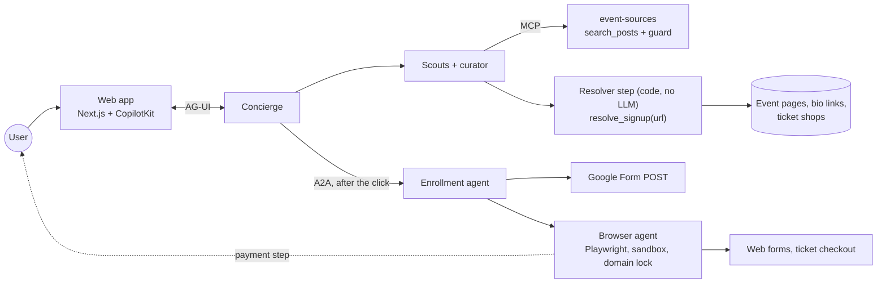

# Sidequest (Event Scout) – Plan after the hackathon

> Status: 2026-11-27. Current state and next steps: section 2. Phases 1, 2 and 4 are done, Phase 3 partly.
> The hackathon plan (deadlines, team split P1–P4, schedule, demo script) is in the git history: `git show b2000e9:PLAN.md`.
>
> **New goal:** Sidequest signs you up for **every** event it suggests. For each event, the app offers the correct next action. The agents do all steps up to the point where the law or the platform needs your own action (pay, send a DM).

## 1. Definition of done

- Every event card has a verified sign-up kind (section 3). Target: less than 10 % `unknown` on live data.
- A card proposes a DM **only** when the post asks for a DM.
- Events without a sign-up ("just go") get time, place, door price, route and a calendar entry. No invented sign-up.
- Free sign-ups (Google Form, other web forms): the agent completes them after one click.
- Tickets: the agent shows a verified price and availability, fills the checkout and stops at the payment step. You confirm the amount and pay.
- "Sign me up for all": one review list for all selected events. Free actions run with one click. Each payment needs its own confirmation.

## 2. Where we are – start here (status 2026-11-27)

**Works** (details in the README):
- **Any city.** Live posts per city: Instagram + TikTok (Apify) and a web search (Firecrawl), cached 24 h in
  `fixtures/live/<city>.json`. The first scan of a new city starts the fetch as a detached process (`fetch_live`,
  log in `data/fetch-<city>.log`; max. 10 per day, 10 min pause after a failed fetch, bookkeeping in `data/cache.db`;
  a city without posts is cached as empty).
- **Interest tags in the live fetch.** The scouts choose hashtags from the interests in the city's language; the fetch
  adds city+interest hashtags (`muenstertechno`) and one Firecrawl search per tag set. New tags on a fresh cache start an
  `--add` fetch (merged into the cache, counts to the daily limit); a full refresh takes up to 6 known tags per city.
  A scan that starts such a fetch tells the user (scan_notes) to ask again in 1-3 min. Not verified live yet.
- **Cards:** summary (extraction LLM, max. 300 chars), image (Instagram `displayUrl`, TikTok cover, og:image; code
  copies it from the post) and an "Open bio link" button for posts with a bio link. The chat shows no second set of
  cards, only a line and "None of these". Field names of Apify/Firecrawl not verified live yet.
- **Card grid:** one card per event with several dates (date chips pick the date the buttons act on), a placeholder
  header when a post has no image, top-k = full rows for the screen width (3 rows) and "Load more events". The date
  filter reads month names too ("5. Dezember", "Dec 5th"); 20 posts per fetch run kept (was 12).
- **Duplicates merged in code** (`_same_event` in agents/scouts/agent.py): same day, ≤ 60 min apart, and equal title
  or same venue + a shared significant title word. The merged event keeps all `sources` and the best info of each
  (signup, longest summary, first image/bio link). TikTok bio links via `clockworks~tiktok-profile-scraper`
  (actor, input and fields checked against the Apify docs, not run live yet).
- **Aggregator pages followed to the original** (`find_original` in resolver.py, plain HTTP, no LLM): a web post with
  ≥ 2 extracted events is a listing; per event the code takes the outbound link in the event's block (mtheapp:
  "Original listing" → luma/meetup/eventbrite) or the detail page and its JSON-LD/outbound link (hamburg-travel).
  Card links and image then come from the original (fallback: the event's image on the listing, never the
  listing's og:image), and the resolver looks for tickets there. Checked offline on the real Hamburg cache; the
  page fetches of the originals are not verified live yet.
  Social list posts (Instagram/TikTok, ≥ 2 events, no links) are listings too: `search_original` (one Firecrawl
  search, results only, no LLM) finds the organiser's page for the first 12 listing events per scan (max 20
  searches/h, 7-day cache); social hosts and the listing's own domain are skipped, ≥ half of the title tokens must
  match. Not run live yet.
- **Shared event catalog.** Events are extracted once per post and shared by all users (`data/cache.db`); per scan only
  the ranking for the user's interests runs. Guard verdicts and resolver results are cached there too.
- **Bio link button only for a verified page:** the resolver returns `event_page` (page shows the title, the day and a
  sign-up word; JSON-LD match, plain text, or Firecrawl markdown); `bio_url` is that page, else none. Offline tests only.
- **Sign-up kinds** (section 3) with the resolver (JSON-LD, Firecrawl fallback for shops like Eventim) and one card
  button per kind.
- **Google sign-in** (Auth.js) with a user id per Google account; sessions persist in SQLite (`data/sidequest.db`).
- **Web form sign-up** in headless Chromium: preview → your "Submit" click → submit (Phase 4).
- **Profile changes in the chat:** "try Dortmund", "add Techno", "next 7 days" → tool `update_profile` (code checks
  the values; name, email and consent stay UI-only), then a new scan; the web app takes the new profile over.
- **LLM:** UniGPT `DeepSeek-V4-Flash` for every call (`LLM_MODEL`), Gemini as fallback. It is a reasoning model:
  extraction, price extraction, scouts and ranking run with reasoning off (`think=False` in `shared/llm.py`; a cold
  city scan went from ~4 min to ~27 s). Guard, concierge and enrollment keep reasoning.
- 122 offline tests (`uv run pytest`); the 10 browser tests need `uv run playwright install chromium`.

**Fixed after the live test of 2026-11-27, re-test in the app:** a scan crashed for a city without posts
("validation error for Ranked"); the chat hung because scouts retried `search_posts` in a loop and each retry could start
a new Apify run; a city without posts was never cached; the same event appeared twice (venue written differently).
Second live test (Rheine, Dortmund): no city ever loaded, because ADK's AgentTool ends the MCP server after every scan
and the fetch thread died with it (every scan started a new, billed Apify run). Now a detached process.
Third live test (Rheine): the city loaded, but the scan took 4 min (reasoning tokens) → reasoning off for simple tasks.

**Not verified live yet:** a new city end to end in the app (detached fetch with real Apify), profile change in the
chat with the web sync, web form sign-up inside the app (no live `web_form` event so far), the Firecrawl search
response format, Google sign-out.

**Known limits:** the concierge trusts any caller on port 8000 (add a shared secret before hosting); a wrongly extracted
event stays in the catalog until the post text changes (delete `data/cache.db` to reset); `unknown` share 1 of 5 on
Münster (target < 10 %, sample too small).

**Next steps, in this order:**
1. Re-test in the app: a new city such as Rheine (the scan waits, progress bar via `GET /progress`, `data/fetch-rheine.log` →
   events or "no posts"), "try Dortmund instead" in the chat (profile + header change, new scan), Münster (warm, fast);
   Google sign-out; profile still there after a concierge restart. Check the Apify usage after the test.
2. Measure the `unknown` share over 3–4 cities (Phase 2 target).
3. A test path for `web_form` in the app (own test form + a fictional fixture post), then preview → submit live.
4. Phase 3 rest: enrollments table with proof, shared secret between the Next.js route and the concierge, privacy
   notice and "delete my data", consent levels.
5. Phase 6 ("Sign me up for all"). Phase 5 only after the decisions in "Before Phase 5".
6. Hosting (Phase 7): Postgres URLs instead of SQLite, the browser in a container.

The gap table of 2026-11-22 (all closed by Phases 1–4) is in the git history.

### The demo bug: a club night got "sign up by DM"

Example from the live data: "TANZ DER VAMPIRE", Sputnikhalle, 21.11.2026. The post only describes the night: DJs, floors, "Eintritt: 10,00€", "Barzahlung und KARTENZAHLUNG an der Kasse". There is no sign-up. Its link goes to a prize draw ("2 x 2 Tickets zu gewinnen"), not to a sign-up. The "Black Friday Vintage Pop-up" in the Cuba Club ("2 € Eintritt") is the same case.

Correct behavior:
1. The post says how to get in at the door, or it gives no sign-up hint → the resolver looks for a ticket shop (section 4). If it finds none → **"Just go"**: time, place, door price, route, calendar link. No message.
2. A ticket shop exists (in the post, in the bio, on the organizer website) → **"Buy ticket · 10 €"** with the verified offer.
3. The post asks for a DM or an email → message draft (exists today).

## 3. Sign-up kinds (the core change)

`signup` replaces `enrollment_mode`. **Code** sets the final value. The LLM only proposes it.

| `signup` | Detected by | Agent does | You do | Result status |
|---|---|---|---|---|
| `none` | "Eintritt frei", "Abendkasse", "keine Anmeldung nötig", or no hint and the resolver finds no ticket shop | Calendar link, route link (`mapsOpenUrl` in `web/lib/maps.ts`), door price from the post | Go there | `not_needed` |
| `google_form` | Link host `docs.google.com/forms` or `forms.gle` (code check, exists) | HTTP POST (exists) | One click | `registered` |
| `web_form` | Resolver finds a free registration page on another site | Browser agent fills name and email, shows a screenshot, submits after your confirmation | Click + confirm | `registered` |
| `tickets` | Resolver finds a ticket offer (post link, bio link, organizer website) | Reads price and availability, fills the checkout up to the payment step | Confirm the amount, pay | `purchased` |
| `message` | Post text asks for a DM or an email (code regex: `DM`, `Direktnachricht`, `schreib uns`, `per Mail`, an email address) | Draft + chat link (exists). Later: send the email with the Gmail API after your confirmation | Send the DM | `manual` |
| `link_in_bio` | Post says "Link in Bio" | Intermediate value only. The resolver replaces it | – | – |
| `unknown` | Resolver finds nothing and the post says a sign-up is required | Post link + "No sign-up link found". **Never** a DM draft | Open the post | `manual` |

Rules in code, not in the prompt:
- `message` only if the post text matches the DM/email pattern. Otherwise `unknown`.
- `google_form` only from the host check. `tickets` and `web_form` only from a resolver result, never from the LLM alone.
- The enrollment path follows `signup` in code. The `before_tool_callback` blocks `prepare_message_signup` if `signup != "message"`. The LLM only writes the text.
- Prize draws ("Tickets zu gewinnen") are not a sign-up. Later, show them as an extra link.

Schema proposal (`shared/schemas.py` and the mirror `shared/schemas.ts`; agree with the team first, see `CLAUDE.md`):

```python
SignupKind = Literal["none", "google_form", "web_form", "tickets", "message", "link_in_bio", "unknown"]

class TicketOffer(BaseModel):
    url: HttpUrl                  # shop page for this event
    price: str | None = None      # from the shop page, not from the post
    availability: Literal["available", "sold_out", "unknown"] = "unknown"
    checked_at: datetime

class SocialPost(BaseModel):      # new field
    author_bio_url: HttpUrl | None = None   # bio link of the account, from the data provider

class Event(BaseModel):           # enrollment_mode -> signup
    signup: SignupKind = "unknown"
    signup_hint: str = ""         # quote from the post, e.g. "Eintritt 10 € an der Kasse"
    ticket: TicketOffer | None = None

class EnrollmentResult(BaseModel):
    status: Literal["registered", "purchased", "not_needed", "manual", "failed"]
```

## 4. Architecture changes



### Resolver (new, read-only)

Finds the real sign-up path behind a link. It is deterministic code in `mcp_servers/event_sources/` (next to the guard), also exposed as a second MCP tool `resolve_signup(url)`. A code-only step after the curator (a custom `BaseAgent` without an LLM) calls it for each event that has a link or `link_in_bio`.

- **Input:** only URLs from the post text or the account's `author_bio_url`. The LLM cannot add URLs.
- **Limits:** `https` only, public IPs only (no SSRF to `localhost` or private ranges), max. 2 redirects, max. 1 MB, 10 s timeout, no cookies. Max. 1 hop (bio page such as linktr.ee → event page).
- **Ticket offer:** read schema.org JSON-LD first (`Event` → `offers`: `price`, `availability`, `url`). This is code, no LLM. Many ticket shops publish it for Google's event search (check this for each shop we see in the live data). Fallback: guard + small Gemini extraction with an output schema.
- **Bio pages:** choose the link that matches the event title or date.
- **Guard:** the page text goes through `is_poisoned` before an LLM sees it.
- **Cache:** per URL, 1 hour (availability changes).
- *Later:* a web search for "<title> <venue> <date> Tickets", with only result hosts from a ticket-shop allowlist.

### Browser agent (new, in the enrollment agent)

For `web_form` and `tickets`. Start with Playwright MCP (`@playwright/mcp`; `.playwright-mcp/` is already in `.gitignore`). Alternative: the Gemini Computer Use model.

- **Domain lock** in the `before_tool_callback` (same pattern as today): the browser opens only the host of `registration_url` or `ticket.url` from the request, plus known payment provider hosts for the hand-off.
- Fills only profile fields (name, email). A required field that is not in the profile → stop and ask in the chat (human in the loop).
- Captcha, login or account creation → stop, status `manual`, link.
- Before the submit: screenshot + summary in the chat → you confirm. After the submit: screenshot of the confirmation page into the audit log.
- Runs in a sandbox (container), without stored passwords or cookies.

### Ticket purchase in 3 stages

| Stage | What | Who pays | When |
|---|---|---|---|
| **A. Deep link** | Card shows "Buy ticket · 10 €" (verified offer). The click opens the shop page. You mark "bought" with one click | You, in the shop | Phase 2, small |
| **B. Assisted checkout** | The browser agent selects the ticket type and count, fills the buyer data and stops at the payment step. You see the live browser and pay there | You, in the live browser | Phase 5 |
| **C. Agent payment** | AP2 (Agent Payments Protocol, an extension of A2A and UCP) with a mandate that you sign, or UCP checkout, or a partner API of the ticket shop | The agent, within your mandate | Only when ticket shops support it. Evaluate, do not build now |

Rules for B:
- The agent never sees or types card data.
- The agent never clicks the final order button ("zahlungspflichtig bestellen"). German law (§ 312j BGB) wants this confirmation from the consumer.
- The agent stops if the cart total is higher than the price that you confirmed.

## 5. Roadmap

Each phase gives a usable state. Size: S = up to 1 day, M = 2–4 days, L = 1 week or more.

### Phase 1 – The correct next action for each event (fixes the demo bug) · S–M

- [x] Schema change from section 3 (`signup`, `signup_hint`, status `not_needed`), Python and TypeScript.
- [x] Curator prompt: describe the kinds with examples. Example: "club night with only a program and a door price → `none`".
- [x] `_finalize_events`: the code rules from section 3. Deduplicate by normalized title + date + venue, not only by `source_url`.
- [x] Concierge `enroll`: for `none`, answer without A2A (calendar link with `make_calendar_link`, route, door price, status `not_needed`). This is the same short path as the "no consent" case.
- [x] Enrollment agent: route by `signup` in code. The guardrail blocks `prepare_message_signup` if `signup != "message"`.
- [x] Cards: one button per kind: "Just go · add to calendar", "Enroll me", "Buy ticket · price", "Prepare message", "Open post". New status texts.
- [x] Tests: fictional fixture posts that copy the hard live cases (club night with door price → `none`, market with an entry fee → `none`, "Ticket Link in Bio" → `link_in_bio`, "Tickets nur per DM" → `message`). Do not copy the real live posts: they are third-party content (`fixtures/live/` is in `.gitignore` for this reason).

### Phase 2 – Resolver: find the real sign-up path · M

- [x] `fetch_live.py`: also get the account profile from Apify (Instagram and TikTok profile scrapers have a bio link field) and store it as `author_bio_url`.
- [x] `resolve_signup(url)` with the limits from section 4. JSON-LD first, bio pages, LLM fallback with the guard.
- [x] Resolver step after the curator. It sets `signup` and `ticket`. When it finds no ticket shop and the post does not require a sign-up, it sets `none` with the hint "No presale found, entry probably at the door".
- [x] Ticket stage A (deep link) on the card.
- [x] Guard test with a poisoned ticket page fixture.
- [ ] Measure: share of `unknown` on the live posts before and after. Target below 10 %.

> Status 2026-11-23: Phase 1 is done. Phase 2 is done except for these points:
> - The resolver step is a second `after_agent_callback` of the curator, not a separate `BaseAgent`.
> - The LLM fallback for pages without JSON-LD is not built: JSON-LD only, no Gemini cost.
> - `fetch_live.py` has not run with the profile scraper yet.
> - Measurement: 16 of 17 cached live posts have no link in the text, so the resolver needs `author_bio_url`
>   (run `fetch_live` again). rausgegangen.de answers 403 to the resolver.
>
> Status 2026-11-27: The hint "No presale found" is built (`NO_PRESALE`, for every `none` event without a quote).
> `DEMO_MODE=live uv run python -m agents.scouts.smoke` prints the share of `unknown`.
>
> Measurement 2026-11-27 (`fetch_live` with profile scraper: 13 posts, 4 with a bio link, 0 with a link in the text;
> smoke run with `GUARD=gemini`): 3 events, **1 `unknown` (33 %)**, 2 `none`. The sample is too small for the 10 % target.
> The `unknown` event has a bio link directly to its Eventim event page, but Eventim blocks the resolver (timeout; with a
> browser user agent only a 3 KB bot page without JSON-LD). A manual Firecrawl test read the page: "Kategorie 1 € 19,15, available".
> Model Armor needs a billing account linked to the GCP project; until then `GUARD=gemini`.
>
> Built 2026-11-27: the LLM fallback of the resolver, via Firecrawl (`FIRECRAWL_API_KEY`, optional). When the plain
> fetch fails (403, timeout) or finds no JSON-LD, Firecrawl renders the page (1 credit, max. 10 pages per hour). Code
> checks title tokens and date on the page, the guard checks the text, Gemini proposes price and availability, and code
> keeps the price only if it is written on the page next to € or EUR. URLs that fail the https / public IP check never
> go to Firecrawl. Open: Eventim and similar shops probably forbid automated access in their terms (see "Before Phase 5");
> the official way is a partner or affiliate feed.
>
> Measurement 2 (2026-11-27, with Firecrawl): 3 events, 1 `tickets` (Date My Friend, 19.15 EUR from Eventim), 1 `none`,
> **1 `unknown` (33 %)**. The `unknown` is a TikTok post "Tickets: Link in Bio" whose author has no bio link in the
> Apify data (TikTok gives `bioLink` only for some accounts). Idea, not built: the post mentions an Instagram handle of
> the organizer; its bio link could come from the Instagram profile scraper (Apify cost).
>
> Measurement 3 (2026-11-27, UniGPT DeepSeek-V4-Flash for all LLM calls): 4 events, 1 `tickets`, 2 `none`,
> **1 `unknown` (25 %)** (the TikTok post without a bio link). The resolver notes are in the audit log now. One run
> before gave `unknown` for the Eventim event with no visible reason (notes were not logged yet). Seen: linktr.ee
> answers 406 to the plain fetch, Firecrawl renders it, but the resolver does not follow links from rendered pages.

### Phase 3 – Real users and real data · M–L

Needed before agents send real sign-ups to real organizers. You can build Phase 4 in parallel against your own test forms.

- [x] Google OAuth sign-in (real name and email). Keep the other providers only as "demo" or remove them.
  *Done 2026-11-27: Auth.js v5 (`web/auth.ts`), other providers labeled "Demo". Open: the concierge still trusts the
  profile from the browser; check the Auth.js session in the CopilotKit route when there are other users.*
- [x] Persistent storage: ADK `DatabaseSessionService` (SQLite first, Cloud SQL or Firestore later). One table for enrollments and purchases, with the proof (`approved_at`, screenshot, confirmation).
  *Done 2026-11-27: sessions in SQLite (`SESSION_DB_URL`), real user id per Google user (route → header → concierge).
  Shared public cache (`CACHE_DB_URL`, `shared/store.py`): event catalog per post (extraction once, ranking per user),
  guard verdicts, resolver results. Both are SQLAlchemy, so Postgres is a URL change when hosting (SQLite does not work
  with several Cloud Run instances). Open: a separate enrollments table (today the proof is in the session state and
  `data/screenshots/`); a shared secret between the Next.js route and the concierge before hosting.*
- [ ] *Postponed (decision 2026-11-27: free tiers only):* Paid Gemini tier or Vertex AI. On the free tier, Google
  can use the data. Until then: only the developer's own data and fictional test data, no other real users.
- [ ] One env file per process (least privilege, open point from the README).
- [ ] Consent levels in the profile: "free sign-ups after my click" (default on), "ask me before every payment" (always on). Privacy notice, "delete my data".
- [ ] Live scan per request instead of the offline cache: Apify run on demand, cached, with a cost limit per user.
  *Partly done 2026-11-27: any city. Cache per city (`fixtures/live/<slug>.json`, 24 h); a missing or stale cache
  starts one Apify run (max. 5 per day and server process); *2026-11-28: the scan now waits for it* (poll every 2 s, max. 240 s;
  failure, daily limit or timeout: old cache, else SOURCE_UNAVAILABLE "cannot be loaded: <reason>"). Progress: `fetch_live`
  writes `fetches/progress-<slug>`, the scout pipeline writes `progress/<user id>`, `GET /progress` (`shared/progress.py`)
  returns `{active, pct, stage, text}`; the frontend polls it.
  Open: limit per user, a job queue instead of the in-process thread.*

### Phase 4 – Browser agent for web forms (`web_form`) · M

- [x] ~~Playwright MCP in a container~~ Deterministic Python Playwright (`agents/enrollment/browser.py`), no LLM in the
  browser, with the domain lock and the stop rules from section 4. *Done 2026-11-27. Open: runs on the host, not in a
  container (`shortcut:`); a container when other users use the app.* Form choice: the first form with a name and an
  email field (skips newsletter/search forms). Success only if the path changes or new success words appear.
- [x] Screenshot before the submit → confirmation in the chat (frontend tool `confirm_submit`) → submit → screenshot of the confirmation
  (`data/screenshots/`, git-ignored). Name and email always come from the request, never from the LLM.
- [x] Tests against own test forms: local HTML forms via `page.route`, real headless Chromium (`tests/test_browser.py`).
  Open: a live test against a real free registration page; a pretix test shop.

### Phase 5 – Tickets: assisted checkout (stage B) · L

- [ ] Browser hand-off: you see the live browser (local headed Chrome first; for other users a cloud browser with a live view).
- [ ] Cart total check against the confirmed price. Stop at the payment step.
- [ ] Legal check before public use: terms of the ticket shops (automation), § 312j BGB, personalized tickets, refunds.
- [ ] Evaluate stage C: which ticket shops in Germany support AP2, UCP or a partner API? Ask shops for partner access.

#### Before Phase 5: points to consider

Legal (check before the first real purchase, not legal advice):
- **§ 312j BGB:** the consumer clicks the order button. The agent stops before it, always.
- **No right of withdrawal:** for leisure events on a fixed date there is no 14-day withdrawal (§ 312g (2) no. 9 BGB).
  A wrong purchase cannot be undone. The confirmation before the hand-off must show event, date, count, ticket type
  and total clearly.
- **Terms of the ticket shops:** many shops forbid bots or automated access. Check each shop before the agent opens it.
  A shop that forbids it stays at stage A (deep link).
- **Personalized tickets:** the name on the ticket must be the attendee. Tickets for friends = data of third persons.
- **GDPR:** the agent gives name and email to the shop. Screenshots in the audit log contain personal data: how long
  are they kept, who can see them.
- **Liability:** who pays if the agent selects the wrong ticket type or count. Until this is clear: personal use only.

Technical:
- **Total check:** compare the cart total with the confirmed price including service fee and shipping. Define the
  tolerance (proposal: 0 €, every difference stops the agent).
- **Price changes and sold out** between the card (`checked_at`) and the checkout: stop, show the new price, ask again.
- **Waiting rooms, captchas, queues, reservation timers:** stop and hand over, never solve them.
- **Shop login or account creation:** the user does it in the live browser. The agent does not store passwords or
  cookies.
- **Payment hosts:** an allowlist of payment provider hosts for the hand-off. The agent never acts on a payment page.
- **Test target:** pretix (open source, has a test mode) before any real shop.

Decisions for the human:
1. Stage B at all, or stage A (deep link) only until a shop gives partner access.
2. Browser hand-off: local headed Chrome (free, only for the developer) or a cloud browser with a live view (costs
   money, needed for other users). With the free-tier rule: local only.
3. Which shops first (the shops in the live data, after their terms are checked).
4. Tolerance of the total check.
5. Ticket count: one ticket for the user only, or also tickets for friends.
6. Stage C: build it only when a German shop supports AP2, UCP or a partner API.

### Phase 6 – "Sign me up for all" · M

- [ ] Button "Plan all" over the card list → review list with one row per event: planned action and cost (free sign-up, ticket 10 €, just go, DM). You can remove rows. One click starts all free actions. Each payment still needs its own confirmation.
- [ ] `choose_event` returns a list of `event_id`s with one `approved_at`. The guardrails check each event.
- [ ] Real calendar entries with the Calendar API (scope `calendar.events`) instead of template links.
- [ ] "My events" view: registered, ticket bought, just go, action needed.
- [ ] *Stretch:* read confirmation emails (Gmail API, read-only, filtered) → status "confirmed". Reminder the day before.

### Phase 7 – Operations, when there are users · M

- [ ] Cloud Run for the concierge, the enrollment agent and the web app. Model Armor as the default guard. Cloud Trace. Cost limits.
- [ ] More sources: rausgegangen.de, Eventbrite, Meetup (check their APIs and terms first). X and Facebook still need an API review.
- [ ] *Stretch from the hackathon:* event cards as A2UI.

## 6. Security: what changes

The key message stays: **the system prompt is a request, the tool set is the boundary.** Code checks every action. New capabilities bring new risks:

| New capability | Risk | Control |
|---|---|---|
| Resolver reads web pages | SSRF, prompt injection from pages | URLs only from the post or the bio, `https` + public IPs, size and time limits, guard before every LLM |
| Browser agent | A page leads the agent to other sites or makes it leak data | Domain lock in code, only profile fields, sandbox, no stored passwords, screenshot audit |
| Ticket purchase | Wrong amount, unwanted purchase, card data | The agent never sees card data, you pay, total check against the confirmed price. Later: AP2 mandate with a limit |
| Real personal data | GDPR | Paid Gemini tier, store only what is needed, "delete my data", privacy notice |
| "Sign me up for all" | One click starts many actions | Review list, a check per event, a separate confirmation for each payment |

Everything from the hackathon stays: injection guard in the MCP server (fail closed), read-only scouts, enrollment only after a real click (`approved_at`), no invented events or links, audit log.

## 7. Open decisions

- ~~**Team**~~ Decided 2026-11-27: one developer continues alone. The plan has no owners.
- ~~**Budget per month**~~ Decided 2026-11-27: free tiers only (Gemini API free tier, Apify free plan). No paid
  Gemini, no Vertex AI, no cloud browser. Consequence: no real personal data of other users (Phase 3), Phase 7 waits.
- ~~**LLM provider**~~ Decided 2026-11-27: UniGPT (Uni Münster, OpenAI-compatible, 30 requests/min, key valid until
  2027-11-27), model `DeepSeek-V4-Flash` for all calls. Switch: `LLM_MODEL` / `LLM_SMALL_MODEL` in `.env`
  (`shared/llm.py`, LiteLLM); `gemini-...` still works as fallback. Open: check the UniGPT terms of use before other
  users use the app. If UniGPT keeps the data at the university, the free-tier data concern of Phase 3 is gone for LLM calls.
- **Browser hand-off and legal risk:** see "Before Phase 5: points to consider" in section 5.
- **Region:** only Münster, or more cities (the sign-in screen now says "your region").

## 8. Accounts and keys for the next phases

| What | Phase | Steps (👤 = a human does it) |
|---|---|---|
| Google Cloud project with billing | 3 | 👤 Create the project, link billing, enable the Gemini API or Vertex AI |
| OAuth consent screen + client ID | 3, 6 | 👤 Scopes `openid email profile`. Later `calendar.events` and `gmail.readonly`: for a public app, Google must verify these sensitive scopes |
| Apify (exists) | 2 | Add the Instagram and TikTok profile scrapers to `fetch_live.py` |
| Playwright | 4 | No account. `npx @playwright/mcp@latest` |
| Cloud browser with live view | 5 | Optional, only for other users. Choose a provider in Phase 5 |

Secrets stay in `.env` only (rules in `CLAUDE.md`).

## 9. Sources

- ADK: https://adk.dev/get-started/python/ · MCP tools: https://adk.dev/tools-custom/mcp-tools/ · A2A: https://adk.dev/a2a/quickstart-exposing/
- AG-UI + ADK: https://github.com/ag-ui-protocol/ag-ui/tree/main/integrations/adk-middleware/python · CopilotKit HITL: https://docs.copilotkit.ai/google-adk/human-in-the-loop
- Playwright MCP: https://github.com/microsoft/playwright-mcp
- schema.org Event and Offer: https://schema.org/Event, https://schema.org/Offer
- AP2: https://ap2-protocol.org/ · UCP: https://ucp.dev/, https://developers.google.com/merchant/ucp
- § 312j BGB (order button): https://www.gesetze-im-internet.de/bgb/__312j.html
- Gemini API terms (free tier data use): https://ai.google.dev/gemini-api/terms
- Model Armor: https://docs.cloud.google.com/model-armor/sanitize-prompts-responses · Apify: https://apify.com/apify/instagram-profile-scraper
