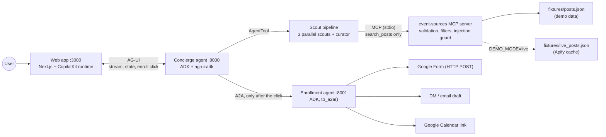

# Sidequest (Event Scout)

**Less scrolling. More going.**

Sidequest is a multi-agent system that finds local events on social media and signs you up for them. Agents read public posts from Instagram, TikTok and the web, rank the events against your interests and show them as cards in a web app. When you click **Enroll me**, a separate enrollment agent fills in the event's Google Form for you. If the event has no form, you get step-by-step instructions, a ready-to-send message and a calendar link.

We built it at the DevFest Münster 2026 Agentic AI Hackathon with Google ADK and Gemini. The detailed plan and the team split are in [PLAN.md](PLAN.md).

## The problem

Many good events in a city are not in an event calendar. They are in Instagram posts, TikTok videos and small websites. Each event has its own sign-up: a Google Form, a DM, "link in bio". Sidequest does the scrolling for you. It signs you up only after you click.

## Architecture



### Components

| Component | Folder | What it does |
|---|---|---|
| Web app | `web/` | Next.js 16 + CopilotKit 1.90 (self-hosted runtime, no CopilotKit Cloud). Sign-in, socials, preferences, event cards and map, chat, activity panel. Details: [web/README.md](web/README.md) |
| Concierge | `agents/concierge/` | Main agent (`gemini-3.8-flash`). Reads the profile from the AG-UI state, starts the scout pipeline, shows the events through the frontend tool `choose_event`, and sends an `EnrollmentRequest` over A2A after the click |
| Scouts + curator | `agents/scouts/` | One scout per platform (`instagram`, `tiktok`, `web`), run in parallel on `gemini-3.5-flash-lite`. Each scout chooses its own hashtags and calls `search_posts` once. The curator (`gemini-3.8-flash`) extracts, filters, deduplicates and ranks the events with a reason |
| MCP server | `mcp_servers/event_sources/` | One tool: `search_posts(platform, city, hashtags, days_ahead)`. It validates the input, filters by platform, city and date, and checks every post for prompt injection before any LLM sees it |
| Enrollment agent | `agents/enrollment/` | Separate process, served over A2A. Tools: `submit_google_form`, `prepare_message_signup`, `make_calendar_link` |
| Contracts | `shared/schemas.py`, `shared/schemas.ts` | `UserProfile`, `SocialPost`, `Event`, `EnrollmentRequest`, `EnrollmentResult`, AG-UI `AgentState`. `schemas.py` is the single source of truth |

### Open standards

| Standard | Where we use it |
|---|---|
| **MCP** | Scouts get social posts from the `event-sources` server. They have no other tool |
| **A2A** | The concierge delegates the enrollment to the enrollment agent (own process, own permissions). Agent card: `http://localhost:8001/.well-known/agent-card.json` |
| **AG-UI** | Live stream between the agents and the web app: profile, scan progress, events, enrollment status, audit log. The **Enroll me** click is a human-in-the-loop tool call |

### Security

The system prompt is a request. The tool set is the boundary.

- **Injection guard in the MCP server.** Every post goes through a regex check and then a Gemini classifier (`GUARD=gemini`) or Google Model Armor (`GUARD=model_armor`). Blocked posts only count as `blocked`. If the guard is not available, the server returns no posts (fail closed).
- **Least privilege.** The scouts have one read-only tool. Only the enrollment agent can enroll. Limit: today all processes read the same `.env`. One env file per process is on the roadmap.
- **Approval is a real click.** The click returns `{event_id, approved_at}`. Code, not the LLM, checks this:
  - The concierge enrolls only after a click, only once per event, and only with `consent_enrollment` in the profile. Without consent, the email address stays in the concierge and you get manual steps.
  - The enrollment agent's `before_tool_callback` blocks a form submit if `approved_at` does not match the request or if the form is not the event's own Google Form on `docs.google.com`.
- **No invented events.** After the curator, code removes every event whose `source_url` does not come from a fetched post. It also removes registration links that are not in the post text.
- **Audit log.** Every tool call writes one line to `state["audit"]`. The activity panel in the web app shows it live.

## Status

### What works

- Full flow: profile → parallel scan → ranked event cards → **Enroll me** → A2A enrollment → status on the card and the result in the chat.
- MCP server with input validation, city and date filters, closed error types (`INVALID_INPUT`, `SOURCE_UNAVAILABLE`, `RATE_LIMITED`) and the injection guard. The poisoned demo post gets blocked.
- Guard with Gemini (free) or Model Armor (needs a GCP project).
- Curator filters out past events and events in other cities. Code sets the event id and the `auto` mode (Google Form links only).
- Enrollment agent:
  - Fills in a real Google Form by HTTP POST. It reads the `entry.<id>` field names from the public form page.
  - Prepares a DM or email sign-up: message text, a link that opens the chat (`ig.me`, TikTok profile) and steps. It sends nothing itself.
  - Makes a Google Calendar "add event" link.
- Web app: onboarding, preference import from ChatGPT, Claude or Grok (JSON), cards and map view, chat, scan progress and activity panel.
- Live mode (`DEMO_MODE=live`): real public posts from Instagram and TikTok through Apify, cached in `fixtures/live_posts.json`.
- 18 Python tests (`uv run pytest`): fixtures against the schema, MCP server and guard, concierge guardrails, enrollment tools and guardrail, live fetch selection.

### What is demo or dummy

| Part | Status |
|---|---|
| Sign-in (Google, Instagram, X, Facebook, email) | Demo only. No OAuth. The session is in the browser's `sessionStorage` |
| "Connect" socials | Saves your choice only. Instagram and TikTok also select the scan sources. The concierge gets the list as a hint in the scan message. No real follows or likes are read |
| X and Facebook | Shown as "planned". No scout reads them, and they are not in the shared `Platform` type |
| Social data (default) | `fixtures/posts.json`: 9 fictional German posts (1 poisoned, 1 with a Google Form link, 1 in Berlin, 1 past event) |
| Live data | Fetched offline with `fetch_live.py` (1–3 min per run), not per scan. The server ignores the hashtags for live data and filters only by platform, city and date |
| Users and sessions | One fixed user (`demo_user`), in-memory sessions, no database |
| Map | Keyless Google Maps embed. It shows one event at a time, not one pin per event |
| Calendar | A Google Calendar template link with an assumed duration of 2 hours. No real calendar entry |
| Automatic enrollment | Only for Google Forms with a "Name" and an "Email" question and no sign-in requirement |
| Stub scout pipeline | `agents/concierge/agent.py` has a fallback with 3 fixed events. It is used only if the real scouts cannot be imported |
| Not built (roadmap) | A2UI event cards, Cloud Run deployment, real OAuth, official platform APIs, Playwright form filling |

## Run the demo

### Requirements

- [`uv`](https://docs.astral.sh/uv/) (it gets Python 3.11–3.13 itself)
- Node.js ≥ 20.9
- A free Gemini API key from https://aistudio.google.com/apikey. Each person uses their own key, because the rate limits apply per project.

### 1. Install

```bash
uv sync                      # Python dependencies (add --extra gcp for Model Armor)
npm --prefix web install     # web app dependencies
cp .env.example .env         # then put your GOOGLE_API_KEY into .env
uv run pytest                # optional check, no API calls
```

### 2. Configure `.env`

| Variable | Default | What |
|---|---|---|
| `GOOGLE_API_KEY` | – | **Required.** Gemini key for all agents and the guard |
| `GEMINI_MODEL` | `gemini-3.8-flash` | Model for the concierge, curator and enrollment agent. Fallback when rate-limited: `gemini-3.5-flash-lite` |
| `DEMO_MODE` | `fixtures` | `fixtures` = demo posts, `live` = Apify cache (see below) |
| `GUARD` | `gemini` | `gemini` (free) or `model_armor` (needs `GOOGLE_CLOUD_PROJECT` and `MODEL_ARMOR_TEMPLATE`) |
| `APIFY_TOKEN` | – | Only for `fetch_live.py` |
| `ENROLLMENT_A2A_URL` | `http://localhost:8001` | Where the concierge finds the enrollment agent |
| `DEMO_FORM_URL` | – | Only used by the stub scout pipeline. The real Google Form link is in `fixtures/posts.json` |

The web app needs no secrets. Optional: `web/.env.local` with `CONCIERGE_URL` (default `http://localhost:8000/`).

### 3. Start

Start all three processes in one terminal:

```bash
npx concurrently "uv run uvicorn agents.concierge.app:app --port 8000" \
                 "uv run uvicorn agents.enrollment.agent:a2a_app --port 8001" \
                 "npm --prefix web run dev"
```

Then open http://localhost:3000. The concierge starts the MCP server itself over stdio.

With `DEMO_MODE=fixtures`, the demo needs no internet service except Gemini (and the Google Form for the enrollment).

To test only the scouts, without the web app:

```bash
uv run python -m agents.scouts.smoke
```

### 4. Demo script (about 2 minutes)

1. **Sign in** with any demo provider. Add Instagram and TikTok.
2. **Preferences:** persona "Lea", Münster, interests AI, Techno, Startups, next 14 days. Turn on "May enroll me after my click".
3. **Scan:** the activity panel shows each scout's tool call and **1 post blocked** (the poisoned post).
4. **Cards:** the events are ranked with a reason. The Berlin hackathon and the past light festival are not there: the curator filtered them out.
5. **Enroll me** on the AI & Agents Meetup → A2A → status **registered**. The response shows up in the Google Form's "Responses" tab. You also get a calendar link.
6. **Enroll me** on the Techno Night → status **manual**, with a ready-to-send DM ("tickets via DM").

Before the demo, delete old test responses in the Google Form.

### Optional: live data

```bash
# APIFY_TOKEN in .env (free Apify account, no card)
uv run python -m mcp_servers.event_sources.fetch_live   # writes fixtures/live_posts.json
# then set DEMO_MODE=live in .env and restart the concierge
```

`fixtures/live_posts.json` contains real third-party posts. It is in `.gitignore`. Do not commit it. Each live post costs one guard call per scan, so keep the Gemini rate limit in mind.

### Optional: Model Armor

See [PLAN.md, section 8](PLAN.md#8-security-in-detail-for-the-judges-questions) for the `gcloud` setup. Then:

```bash
uv sync --extra gcp
# in .env: GUARD=model_armor, GOOGLE_CLOUD_PROJECT=..., MODEL_ARMOR_TEMPLATE=projects/<p>/locations/europe-west1/templates/event-scout
```

### Checks

```bash
uv run pytest                                   # Python tests
cd web && npx tsc --noEmit && npm run lint      # web app
```

## Repo layout

```
agents/concierge/          main agent + AG-UI FastAPI app (:8000)
agents/scouts/             parallel scouts + curator, smoke test
agents/enrollment/         enrollment agent, A2A server (:8001)
mcp_servers/event_sources/ MCP server with the injection guard, Apify live fetch
web/                       Next.js + CopilotKit web app (:3000)
shared/                    contracts (schemas.py = source of truth, schemas.ts = mirror)
fixtures/posts.json        fictional demo posts
tests/                     pytest tests
PLAN.md                    plan, judging criteria, work packages, risks
```

## Stack

Google ADK 2.15 · Gemini API · MCP (Python SDK 2.x) · A2A · AG-UI (`ag-ui-adk`) · CopilotKit · Next.js 16 · React 19 · TypeScript · Tailwind CSS · FastAPI · uv · Apify (optional) · Model Armor (optional)

## Team

| Package | Owner |
|---|---|
| P1 Onboarding platform (web app, profile, submission) | P1 |
| P2 Scanning social media (MCP server, scouts, guard) | P2 |
| P3 Showing events (concierge, AG-UI) | P3 |
| P4 Enrollment (A2A agent) | P4 |
