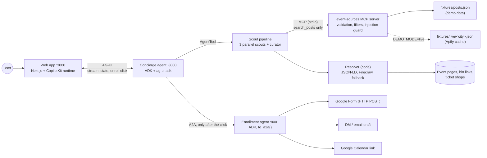

# Sidequest (Event Scout)

**Less scrolling. More going.**

Sidequest is a multi-agent system that finds local events on social media and signs you up for them. Agents read public posts from Instagram, TikTok and the web, rank the events against your interests and show them as cards in a web app. When you click **Enroll me**, a separate enrollment agent fills in the event's Google Form for you. If the event has no form, you get step-by-step instructions, a ready-to-send message and a calendar link.

We built it at the DevFest Münster 2026 Agentic AI Hackathon with Google ADK and Gemini. Today the LLM is configurable: UniGPT (Uni Münster, OpenAI-compatible) or Gemini. The plan for the next steps is in [PLAN.md](PLAN.md).

## The problem

Many good events in a city are not in an event calendar. They are in Instagram posts, TikTok videos and small websites. Each event has its own sign-up: a Google Form, a DM, "link in bio". Sidequest does the scrolling for you. It signs you up only after you click.

## Architecture



### Components

| Component | Folder | What it does |
|---|---|---|
| Web app | `web/` | Next.js 16 + CopilotKit 1.90 (self-hosted runtime, no CopilotKit Cloud). Sign-in, socials, preferences, event cards and map, chat, activity panel. Details: [web/README.md](web/README.md) |
| Concierge | `agents/concierge/` | Main agent (`LLM_MODEL`). Reads the profile from the AG-UI state, starts the scout pipeline, shows the events through the frontend tool `choose_event`, and sends an `EnrollmentRequest` over A2A after the click |
| Scouts + curator | `agents/scouts/` | One scout per platform (`instagram`, `tiktok`, `web`), run in parallel on `LLM_SMALL_MODEL`. Each scout chooses its own hashtags and calls `search_posts` once. Extraction (`LLM_MODEL`) turns each post into events once and stores them in a shared event catalog (`shared/store.py`), so the next scan and every other user of the city reuse them. Code filters by date window and city and deduplicates; the curator (`LLM_MODEL`) only ranks the candidates for the user's interests. Code sets the sign-up kind (`none`, `google_form`, `web_form`, `tickets`, `message`, `unknown`) |
| Resolver | `mcp_servers/event_sources/resolver.py` | Follows the link in the post or the account's bio link and finds a ticket offer or a free registration page. First schema.org JSON-LD (code only). If a shop blocks that or has no JSON-LD: Firecrawl renders the page, the guard checks it, the LLM proposes price and availability, and code keeps the price only if it is on the page |
| LLM switch | `shared/llm.py` | `LLM_MODEL` / `LLM_SMALL_MODEL`: `gemini-...` (Gemini API) or `openai/<model>` (OpenAI-compatible endpoint such as UniGPT, through LiteLLM) |
| MCP server | `mcp_servers/event_sources/` | One tool: `search_posts(platform, city, hashtags, days_ahead)`. It validates the input, filters by platform, city and date, and checks every post for prompt injection before any LLM sees it |
| Enrollment agent | `agents/enrollment/` | Separate process, served over A2A. Tools: `submit_google_form`, `preview_web_form` + `submit_web_form` (headless Chromium via Playwright, deterministic code, domain lock, preview → your **Submit** click → submit), `prepare_message_signup`, `make_calendar_link` |
| Contracts | `shared/schemas.py`, `shared/schemas.ts` | `UserProfile`, `SocialPost`, `Event`, `EnrollmentRequest`, `EnrollmentResult`, AG-UI `AgentState`. `schemas.py` is the single source of truth |

### Open standards

| Standard | Where we use it |
|---|---|
| **MCP** | Scouts get social posts from the `event-sources` server. They have no other tool |
| **A2A** | The concierge delegates the enrollment to the enrollment agent (own process, own permissions). Agent card: `http://localhost:8001/.well-known/agent-card.json` |
| **AG-UI** | Live stream between the agents and the web app: profile, scan progress, events, enrollment status, audit log. The **Enroll me** click is a human-in-the-loop tool call |

### Security

The system prompt is a request. The tool set is the boundary.

- **Injection guard in the MCP server.** Every post goes through a regex check and then an LLM classifier (`GUARD=gemini`, model `LLM_SMALL_MODEL`) or Google Model Armor (`GUARD=model_armor`). Blocked posts only count as `blocked`. If the guard is not available, the server returns no posts (fail closed).
- **Least privilege.** The scouts have one read-only tool. Only the enrollment agent can enroll. Limit: today all processes read the same `.env`. One env file per process is on the roadmap.
- **Approval is a real click.** The click returns `{event_id, approved_at}`. Code, not the LLM, checks this:
  - The concierge enrolls only after a click, only once per event, and only with `consent_enrollment` in the profile. Without consent, the email address stays in the concierge and you get manual steps.
  - The enrollment agent's `before_tool_callback` blocks a form submit if `approved_at` does not match the request or if the form is not the event's own Google Form on `docs.google.com`.
- **No invented events.** After the curator, code removes every event whose `source_url` does not come from a fetched post. It also removes registration links that are not in the post text.
- **Resolver limits.** Only URLs from the post text or the bio link, `https` only, public IPs only, max. 2 redirects, 1 MB, 10 s. Such checks also run before a URL goes to Firecrawl (max. 10 pages per hour). The LLM never adds URLs.
- **Audit log.** Every tool call and every resolver result writes one line to `state["audit"]`. The activity panel in the web app shows it live.

## Status

### What works

- Full flow: profile → parallel scan → ranked event cards → **Enroll me** → A2A enrollment → status on the card and the result in the chat.
- MCP server with input validation, city and date filters, closed error types (`INVALID_INPUT`, `SOURCE_UNAVAILABLE`, `RATE_LIMITED`) and the injection guard. The poisoned demo post gets blocked.
- Guard with the configured LLM (free) or Model Armor (needs a GCP project with billing).
- Curator filters out past events and events in other cities. Code sets the event id and the sign-up kind and deduplicates by title, venue and day. The card shows one button per kind: "Just go", "Enroll me", "Buy ticket · price", "Prepare message", "Open post".
- Resolver: ticket offers from JSON-LD or, through Firecrawl, from shops that block plain HTTP (tested live on Eventim).
- Enrollment agent:
  - Fills in a real Google Form by HTTP POST. It reads the `entry.<id>` field names from the public form page.
  - Prepares a DM or email sign-up: message text, a link that opens the chat (`ig.me`, TikTok profile) and steps. It sends nothing itself.
  - Makes a Google Calendar "add event" link.
- Web app: onboarding, preference import from ChatGPT, Claude or Grok (JSON), cards and map view, chat, scan progress and activity panel.
- Live mode (`DEMO_MODE=live`): real public posts from Instagram and TikTok through Apify, cached per city in `fixtures/live/<city>.json`.
- 60 Python tests (`uv run pytest`, offline): fixtures against the schema, MCP server and guard, sign-up rules, resolver and Firecrawl fallback, LLM switch, concierge guardrails, enrollment tools and guardrail, live fetch selection.

### What is demo or dummy

| Part | Status |
|---|---|
| Sign-in (Google, Instagram, X, Facebook, email) | Demo only. No OAuth. The session is in the browser's `sessionStorage` |
| "Connect" socials | Saves your choice only. Instagram and TikTok also select the scan sources. The concierge gets the list as a hint in the scan message. No real follows or likes are read |
| X and Facebook | Shown as "planned". No scout reads them, and they are not in the shared `Platform` type |
| Social data (default) | `fixtures/posts.json`: 9 fictional German posts (1 poisoned, 1 with a Google Form link, 1 in Berlin, 1 past event) |
| Live data | Fetched offline with `fetch_live.py` (1–3 min per run), not per scan. The server ignores the hashtags for live data and filters only by platform, city and date |
| Users and sessions | Google users get their own id (`google:<email>`, set server-side by the Next.js route), demo logins share `demo_user`. Sessions persist in SQLite (`data/sidequest.db`). The concierge trusts any caller on its port: add a shared secret before hosting |
| Map | Keyless Google Maps embed. It shows one event at a time, not one pin per event |
| Calendar | A Google Calendar template link with an assumed duration of 2 hours. No real calendar entry |
| Automatic enrollment | Google Forms with a "Name" and an "Email" question, and simple web forms (name, email, required checkboxes). Stops on login, captcha, other required fields, or a form that sends to another site |
| Stub scout pipeline | `agents/concierge/agent.py` has a fallback with 3 fixed events. It is used only if the real scouts cannot be imported |
| Not built (roadmap) | A2UI event cards, Cloud Run deployment, official platform APIs, ticket checkout (Phase 5), browser in a container |

## Run the demo

### Requirements

- [`uv`](https://docs.astral.sh/uv/) (it gets Python 3.11–3.13 itself)
- Node.js ≥ 20.9
- An LLM key: a UniGPT key (Uni Münster, `https://gpt.uni-muenster.de/v1`) or a free Gemini API key from https://aistudio.google.com/apikey. Each person uses their own key, because the rate limits apply per key.

### 1. Install

```bash
uv sync                      # Python dependencies (add --extra gcp for Model Armor)
uv run playwright install chromium   # browser for web form sign-ups (about 100 MB)
npm --prefix web install     # web app dependencies
cp .env.example .env         # then put your UNIGPT_API_KEY (or GOOGLE_API_KEY) into .env
uv run pytest                # optional check, no API calls
```

### 2. Configure `.env`

| Variable | Default | What |
|---|---|---|
| `LLM_MODEL` | `GEMINI_MODEL` | Model for the concierge, curator and enrollment agent: `openai/DeepSeek-V4-Flash` (UniGPT) or `gemini-...` |
| `LLM_SMALL_MODEL` | `gemini-3.5-flash-lite` | Model for the scouts, the guard and the price extraction |
| `UNIGPT_BASE_URL`, `UNIGPT_API_KEY` | – | **Required for `openai/` models.** UniGPT endpoint and key |
| `GOOGLE_API_KEY` | – | **Required for `gemini-` models** |
| `GEMINI_MODEL` | `gemini-3.8-flash` | Used when `LLM_MODEL` is empty |
| `DEMO_MODE` | `fixtures` | `fixtures` = demo posts, `live` = Apify cache (see below) |
| `GUARD` | `gemini` | `gemini` (free) or `model_armor` (needs `GOOGLE_CLOUD_PROJECT` and `MODEL_ARMOR_TEMPLATE`) |
| `APIFY_TOKEN` | – | Only for `fetch_live.py` |
| `FIRECRAWL_API_KEY` | – | Optional. Resolver fallback for ticket shops that block plain HTTP (1 credit per page) |
| `ENROLLMENT_A2A_URL` | `http://localhost:8001` | Where the concierge finds the enrollment agent |
| `SESSION_DB_URL` | `sqlite+aiosqlite:///data/sidequest.db` | ADK sessions (profile, events, enrollments, audit). Postgres later: change the URL |
| `CACHE_DB_URL` | `sqlite:///data/cache.db` | Shared public cache: event catalog per post, guard verdicts, resolver results (1 h) |
| `DEMO_FORM_URL` | – | Only used by the stub scout pipeline. The real Google Form link is in `fixtures/posts.json` |

The web app needs no secrets yet. Optional: `web/.env.local` with `CONCIERGE_URL` (default `http://localhost:8000/`). `AUTH_GOOGLE_ID`, `AUTH_GOOGLE_SECRET` and `AUTH_SECRET` are prepared for the Google sign-in (PLAN.md, Phase 3) and not used yet.

### 3. Start

Start all three processes in one terminal:

```bash
npx concurrently "uv run uvicorn agents.concierge.app:app --port 8000" \
                 "uv run uvicorn agents.enrollment.agent:a2a_app --port 8001" \
                 "npm --prefix web run dev"
```

Then open http://localhost:3000. The concierge starts the MCP server itself over stdio.

With `DEMO_MODE=fixtures`, the demo needs no internet service except the LLM (and the Google Form for the enrollment).

To test only the scouts, without the web app:

```bash
uv run python -m agents.scouts.smoke
```

### 4. Demo script (about 2 minutes)

1. **Sign in** with any demo provider. Add Instagram and TikTok.
2. **Preferences:** persona "Lea", Münster, interests AI, Techno, Startups, next 14 days. Turn on "May enroll me after my click".
3. **Scan:** the activity panel shows each scout's tool call and **1 post blocked** (the poisoned post).
4. **Cards:** the events are ranked with a reason. The Berlin hackathon and the past light festival are not there: the curator filtered them out.
5. **Enroll me** on the AI & Agents Meetup → A2A → status **registered**. The response shows up in the Google Form's "Responses" tab. You also get a calendar link.
6. **Enroll me** on the Techno Night → status **manual**, with a ready-to-send DM ("tickets via DM").

Before the demo, delete old test responses in the Google Form.

### Optional: live data

```bash
# 1. APIFY_TOKEN in .env (free Apify account, no card). Only when you want new posts:
uv run python -m mcp_servers.event_sources.fetch_live --city "Köln"   # any city, default Münster. 1-3 min, a few cents of Apify credit, writes fixtures/live/koeln.json
# 2. Scouts, curator and resolver on the live posts, without the web app. Prints events, sign-up kinds and the share of unknown:
DEMO_MODE=live uv run python -m agents.scouts.smoke "Köln"   # city optional, default Münster; needs the cache from step 1
# 3. Full app with live data: set DEMO_MODE=live in .env and start the three processes (step 3)
```

With `DEMO_MODE=live` the server also starts this fetch itself (background thread) when a city has no cache or the cache is older than 24 h. The first scan of a new city in the app then says the data is loading: scan again after 1-3 min. Limit: 5 fetches per day and server process. `fixtures/live/` contains real third-party posts. It is in `.gitignore`. Do not commit it. Each live post costs one guard call per scan, and each resolved link can cost one Firecrawl credit. With `FIRECRAWL_API_KEY` set, the fetch also adds a web source (Firecrawl search `Events Veranstaltungen <city>`, 5 pages as markdown, about 7 credits per city fetch: 2 for the search plus 1 per page).

### Optional: Model Armor

Model Armor needs a GCP project with a linked billing account (free credits are enough). The `gcloud` setup is in the hackathon plan: `git show b2000e9:PLAN.md`, section 8. Then:

```bash
uv sync --extra gcp
# in .env: GUARD=model_armor, GOOGLE_CLOUD_PROJECT=..., MODEL_ARMOR_TEMPLATE=projects/<p>/locations/europe-west1/templates/event-scout
```

### Checks

```bash
uv run pytest                                   # Python tests
cd web && npx tsc --noEmit && npm run lint      # web app
```

## Repo layout

```
agents/concierge/          main agent + AG-UI FastAPI app (:8000)
agents/scouts/             parallel scouts + curator + resolver step, smoke test
agents/enrollment/         enrollment agent, A2A server (:8001)
mcp_servers/event_sources/ MCP server with the injection guard, resolver, Apify live fetch
web/                       Next.js + CopilotKit web app (:3000)
shared/                    contracts (schemas.py = source of truth, schemas.ts = mirror), llm.py (model switch)
fixtures/posts.json        fictional demo posts
tests/                     pytest tests
PLAN.md                    plan and roadmap after the hackathon
```

## Stack

Google ADK 2.15 · UniGPT (DeepSeek-V4-Flash) via LiteLLM or Gemini API · MCP (Python SDK 2.x) · A2A · AG-UI (`ag-ui-adk`) · CopilotKit · Next.js 16 · React 19 · TypeScript · Tailwind CSS · FastAPI · uv · Apify (optional) · Firecrawl (optional) · Model Armor (optional)

## Team

| Package | Owner |
|---|---|
| P1 Onboarding platform (web app, profile, submission) | P1 |
| P2 Scanning social media (MCP server, scouts, guard) | P2 |
| P3 Showing events (concierge, AG-UI) | P3 |
| P4 Enrollment (A2A agent) | P4 |
